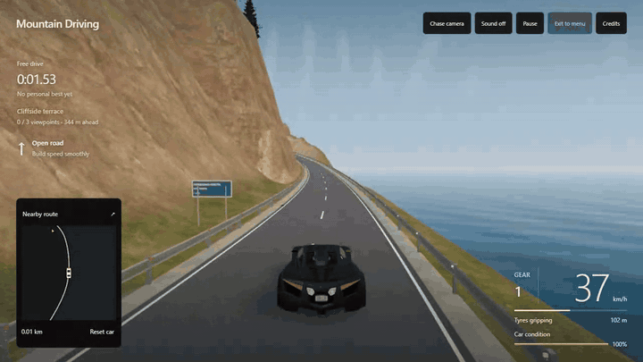
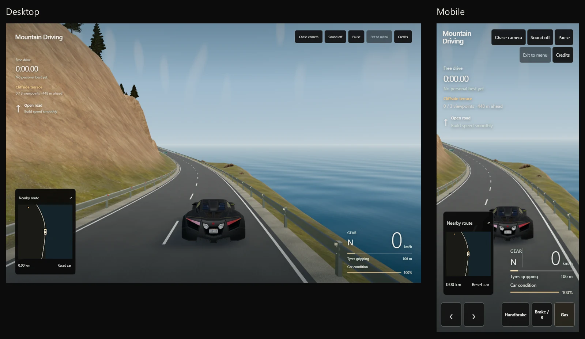

# Mountain Driving

A browser driving game with timed laps, drift challenges and a fictional supercar.

[Play online](https://mountain-driving-game.pages.dev/)



## Play locally

Requires Node.js 22+ and a browser with WebGL 2 and graphics acceleration.

```sh
node scripts/serve.mjs
```

Open [127.0.0.1:8769](http://127.0.0.1:8769). No installation or build is needed
to play. The server is local-only.

**Controls:** WASD / arrow keys to drive, Space to handbrake, C to change camera,
R to reset, Escape to pause. Touch controls are included.

## Routes

- **Coastal Pass:** the original 3.2 km mountain and coastal route.
- **Ocean Road:** a 10.2 km coastal loop.
- **Nürburgring GP:** an unofficial 5.1 km layout with simplified scenery.

Coastal Pass and Sprint are selected by default. Includes free driving,
vehicle damage and personal-best ghosts.

No accounts or analytics. Progress stays in memory and resets on reload or road
change. [Privacy](game/privacy.html).



## Development

JavaScript modules, Three.js and Web Audio; React and Radix UI for dropdowns.
Use pnpm 11.19.0:

```sh
pnpm install --frozen-lockfile --ignore-scripts
pnpm check
pnpm test
```

The playable game is in `game/`.

## Limitations

Work in progress: planar vehicle physics, simplified scenery and driving aids.
Not a full vehicle simulation. Frame rates depend on the device and settings.

## Licence

Original code © 2026 Joni Finskas, [GPL-3.0-only](LICENSE), without warranty.
Third-party assets retain their licences: car model CC BY 4.0, landscape CC0,
engine audio CC BY-SA 4.0, libraries and circuit coordinates MIT. See
[credits and source links](game/credits.txt).
No manufacturer or circuit-owner affiliation or endorsement is implied.
